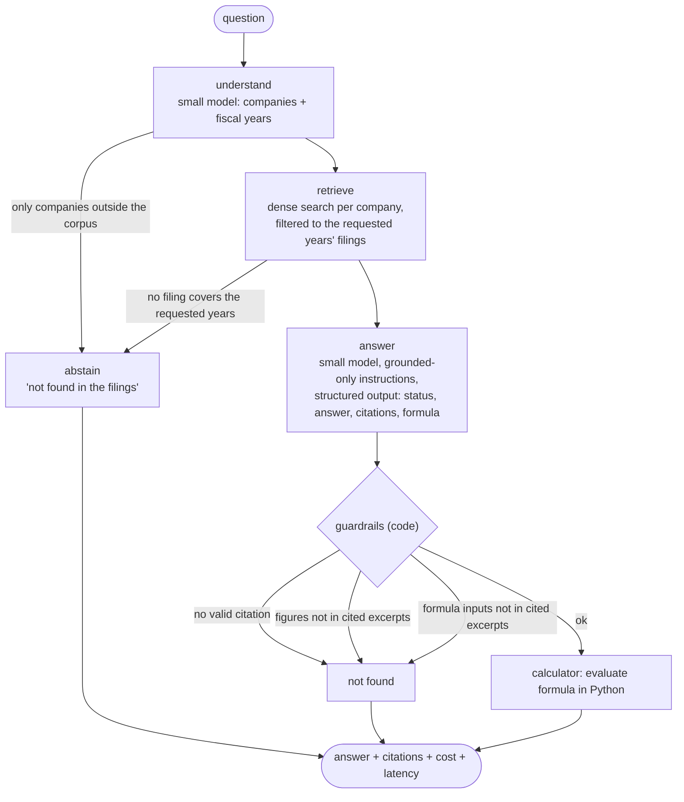
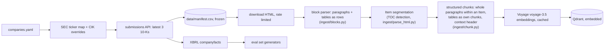
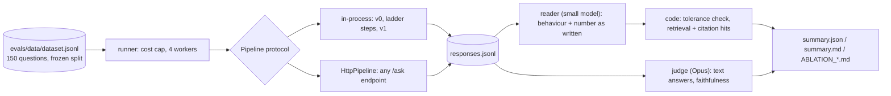

# Architecture

## v1 query flow (LangGraph)

The graph in `src/rescue_rag/agent/graph.py`, with its routing conditions labelled
(`V1Agent().mermaid()` prints the unlabelled version generated from the code).

Answer statuses: `answered`, `not_found`, `premise_false` (the model rejects a premise the
excerpts contradict).

## Ingestion

v0 instead strips HTML to plain text and cuts fixed 1,000-token windows (`naive_chunks`).

## Evaluation harness (`src/rag_eval`)

The harness only needs `{answer, contexts?, citations?, cost_usd?}` from a system under test, so
it can evaluate a client's RAG endpoint over HTTP (the "AI Agent Health Check").
